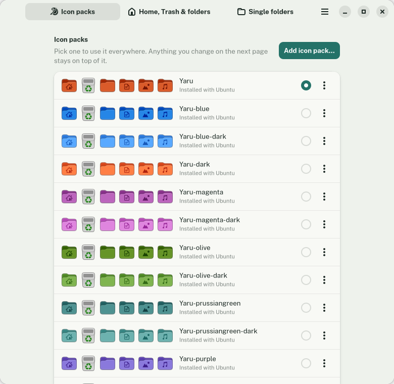
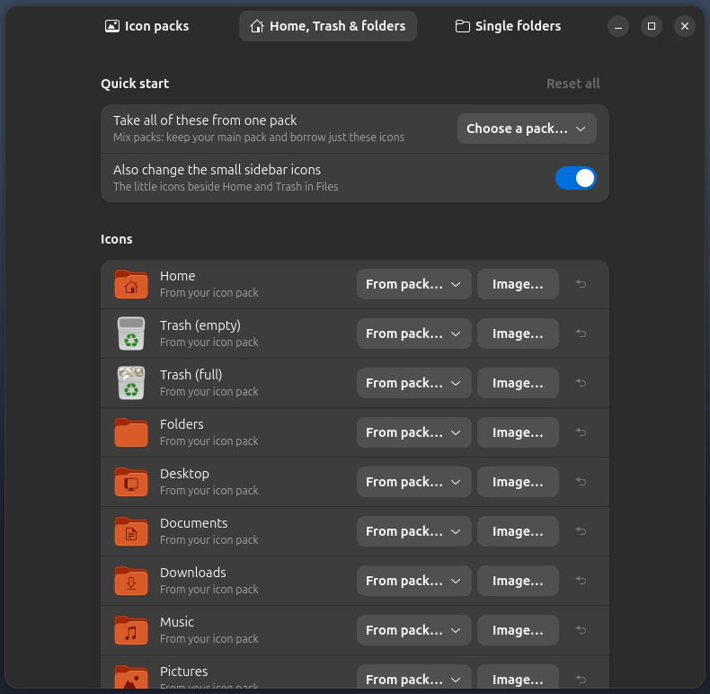
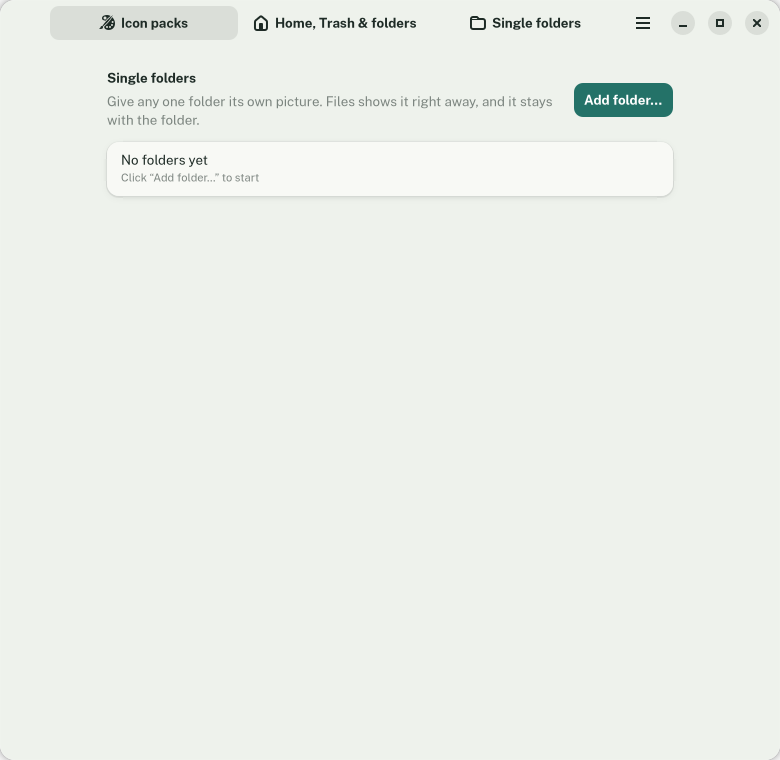

# Fern

*Formerly Shine. Part of the Sedge family of webhookstudios apps.*

Apply an icon pack to Ubuntu with one click, and give Home, Trash and any single folder its own icon.



## What it does

- **Icon packs:** see every installed pack with a live preview, pick one, or add new ones from a `.zip` or `.tar` file.
- **Home, Trash and folders:** change the Home, Trash (empty and full), Desktop, Documents, Downloads, Music, Pictures, Videos, Public and Templates icons, plus the Files app icon. Take them from another pack, or use any image of your own.
- **Mix packs:** keep one pack for everything, and borrow just the Home, Trash and folder icons from another.
- **Single folders:** give one specific folder its own picture. Files shows it right away.
- Changes apply to the whole desktop. **Reset all** goes back to the pack's own icons.





## Requirements

Ubuntu 24.04 or newer with GNOME. Fern has been tested on Ubuntu 26.04 with GNOME Shell 50.1 on Wayland.

## Install

### With the deb package (recommended)

Download `fern_1.1.0_all.deb` from the [latest release](https://github.com/webhookstudios/fern/releases/latest), then install it:

```bash
sudo apt install ./fern_1.1.0_all.deb
```

Open **Fern** from the apps menu. To remove it:

```bash
sudo apt remove fern
```

### From source

```bash
git clone https://github.com/webhookstudios/fern.git
```

```bash
./fern/install.sh
```

## How it works

Fern does not edit your icon packs. Your own choices are written into a small theme called `Shine-Custom` in `~/.local/share/icons/`. It inherits from the pack you picked, so only the icons you changed are different. Fern then sets it as your icon theme. Single folders use the `metadata::custom-icon` setting that Files reads, which stays with the folder.

Your choices are stored in `~/.config/fern/config.json`, and the pictures you chose are kept in `~/.local/share/fern/`.

Icons that apps draw themselves, or that are fixed inside an app, are not changed.

## Development

```bash
FERN_DIR="$PWD/src" gjs -m bin/fern
```

Build the deb into `dist/` with `./build-deb.sh` (needs only `dpkg-deb`).

| File | Purpose |
|---|---|
| `src/main.js` | The window and its three pages |
| `src/iconthemes.js` | Finding, previewing, adding and removing icon packs |
| `src/overrides.js` | Your icon choices, the `Shine-Custom` theme and single folders |

## License

GPL-2.0-or-later. See [LICENSE](LICENSE).
